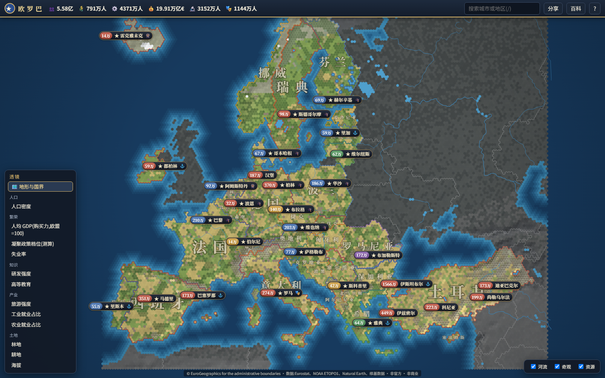
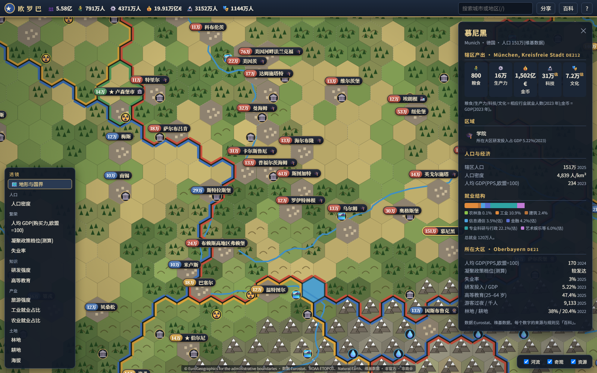
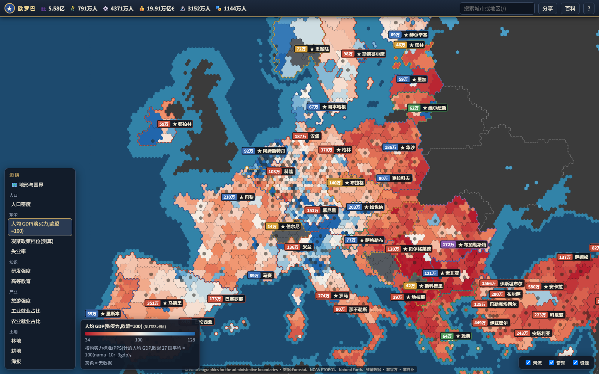

# 欧罗巴策略地图

把真实的欧洲画成一张 4X 策略游戏风格的六边形地图。数据全部来自公开数据源，用游戏的语言重新讲一遍：GDP 是**金币**，农业、工业、科技、文艺的就业人数是**粮食、生产力、科技、文化**，城市凭真实的产业结构获得**区域**（学院、工业区、商业中心……），世界遗产是**奇观**，核电站和大型水电站是**战略资源**。

**在线地图:https://inoichi1009207.github.io/eurociv/**



| 城市面板（慕尼黑） | 透镜：人均 GDP（购买力，欧盟=100） |
|---|---|
|  |  |

灵感来自 Andrej Karpathy 在 2026 年 11 月让 Claude 用美国公开数据做的 [usaciv](https://karpathy.ai/usaciv/)。本仓库是**独立重写**的欧洲版，没有复用它的代码。数据管线、网页和配套的 Claude Code skill 都由 Claude Code（Opus 5.5）生成。

## 有什么

- **37 个国家、1330 个 NUTS3 地区**，约 8400 格有数据的陆地（格心距约 28 km，等积投影，所以格数可以直接比较面积）。
- **499 座城市**（人口 ≥10 万，98% 有中文名），点开可以看所在地区的五项产出、获得的区域和理由、就业结构、所在大区的研发、失业、高教、旅游指标。
- **12 个透镜**：人口密度、人均 GDP（PPS）、凝聚政策档位（测算）、失业率、研发强度、高等教育、旅游强度、工业/农业就业占比、林地、耕地、海拔。
- **390 处世界遗产**作为奇观，**157 座在用的核电站与大型水电站**作为资源。
- **百科**：每一条「游戏化」规则、每个数据源和许可都写在页面里；估算值标「估」。
- 地址栏会保存视图、透镜和选中的城市，复制链接就能分享；「分享」按钮同时导出 PNG。

## 本地运行

需要 Node.js 20 或更高版本。仓库里已经带了生成好的 `site/data/`，直接预览：

```bash
node pipeline/serve.mjs        # 打开 http://127.0.0.1:8765/
```

从头重建（下载约 15 MB 原始数据；海拔采样要调用 OpenTopoData 公共 API 约 500 次，大约 10 分钟）：

```bash
npm install                    # 只装一个构建期依赖 opencc-js(繁转简)
node pipeline/fetch.mjs        # 1 下载 → raw/
node pipeline/grid.mjs         # 2 六边形网格、陆地判定、地区归属
node pipeline/elev.mjs         # 3 海拔采样(可断点续跑)
node pipeline/build.mjs        # 4 生成 site/data/*.json
node pipeline/check.mjs        # 5 核对(退出码 0 才算通过)
```

`check.mjs` 用机器判据核对，任何一项不过就以非零退出：

- 各国 NUTS3 的 GDP 和人口之和对国家值逐年对账（最大偏差 < 0.01%）；
- 全部 1330 个地区的人口、GDP、总就业与原始数据的最新年份值逐条一致；产出缺数据时为空、不显示成 0；
- 随机 400 个格子用原始边界独立复算归属（一致率 ≥ 90%，其余是边境格多数票的正常差异）；
- 每条城市区域的理由按独立算出的区位商重算，必须真的过阈值；
- 电站不得是退役、关闭或在建状态，装机量级合理；城市坐标不得落在无数据国家境内；
- 罗马、巴黎、柏林、华沙、维也纳落在正确地区并标为首都。

## 游戏化规则（摘要）

| 游戏概念 | 真实数据 |
|---|---|
| 🌾 粮食 | 农林渔就业人数（NACE A） |
| ⚙️ 生产力 | 工业 + 建筑就业人数（B–E、F） |
| 💰 金币 | 地区 GDP，当年价 |
| 🔬 科技 | 信息通信 + 专业科研技术就业人数（J、M–N） |
| 🎭 文化 | 艺术娱乐及其他服务就业人数（R–U） |
| 🎓 学院 | 所在大区研发投入 ≥ GDP 的 3%，或科技就业区位商 ≥ 1.6 |
| 🏭 工业区 / 🏦 商业中心 / 🎭 剧院广场 | 对应行业就业区位商 ≥ 1.4 / 1.5 / 1.5 |
| 🎡 娱乐中心 | 每千居民游客过夜 ≥ 12000 晚 |
| 🏛️ 政府广场 | 国家首都 |
| 森林、平原、荒漠 | 按各大区 LUCAS 土地覆盖比例分配到格子 |
| 丘陵、山脉 | 格内海拔起伏（ETOPO1） |

完整规则见页面「百科」或 [`pipeline/rules.mjs`](pipeline/rules.mjs)。

## 覆盖与缺口

- **有数据**：欧盟 27 国、挪威、瑞士、冰岛，以及阿尔巴尼亚、黑山、北马其顿、塞尔维亚、土耳其、科索沃。列支敦士登面积太小，没有分到格子。波黑在 NUTS 里只有 NUTS2 边界、没有统计数据，按迷雾处理。
- **迷雾（只画地形）**：英国（脱欧后不在 NUTS 2024 中）、乌克兰、白俄罗斯、俄罗斯、北非、中东等。
- **未画入**：法国海外省、加那利群岛、亚速尔群岛、马德拉群岛、斯瓦尔巴（共约 507 万人）。
- **估算**：约 500 个地区的 NUTS3 就业只报到大类，信息通信、金融、专业服务、艺术娱乐按「本地区父类 × 本国比例」估算并标「估」。区位商的全图基准只用实报值，依赖细分行业的区域（学院的就业条件、商业中心、剧院广场）遇到估算值不判定。生产力等合计类产出只要有一个分量缺报就留空。
- 城市的产出是它**所在 NUTS3 地区**的合计，不是城区本身。马德里（ES300 是整个马德里自治区）这类地区的产出因此偏大。

## 数据与许可

| 数据 | 许可 |
|---|---|
| Eurostat 地区统计 | CC BY 4.0。本项目对数据做了加工（选年份、估算细分行业、映射为游戏术语），加工后的数据与 Eurostat 无关，Eurostat 不对其承担责任 |
| GISCO NUTS 2024 边界 | **© EuroGeographics for the administrative boundaries**，仅限非商业用途 |
| NOAA ETOPO1（经 OpenTopoData） | 美国政府作品，公有领域 |
| Natural Earth | 公有领域 |
| 维基数据 | CC0 |

代码与文档使用 MIT 许可。**因为 NUTS 边界仅限非商业用途，基于本仓库数据的商业使用需要另行取得 EuroGeographics 的授权。**
本项目与任何游戏公司无关，也不使用任何游戏的美术素材。

## Claude Code skill：给任意地区做一张

[`skills/real-data-4x-map/`](skills/real-data-4x-map/SKILL.md) 把这套做法写成了 skill：怎么选统计单元，怎么写游戏化规则，怎么核对，踩过的坑，以及完整的参考实现模板。装上之后对 Claude 说「把日本做成策略游戏风格的地图」就会按这个流程走。

安装方式一（作为插件）：

```text
/plugin marketplace add inoichi1009207/eurociv
/plugin install real-data-4x-map@eurociv
```

安装方式二（只拷 skill）：把 `skills/real-data-4x-map/` 整个目录复制到 `~/.claude/skills/`。

改动参考实现后运行 `node pipeline/pack-skill.mjs` 同步模板；发布前运行 `node pipeline/pack-skill.mjs --check` 确认模板已同步。
